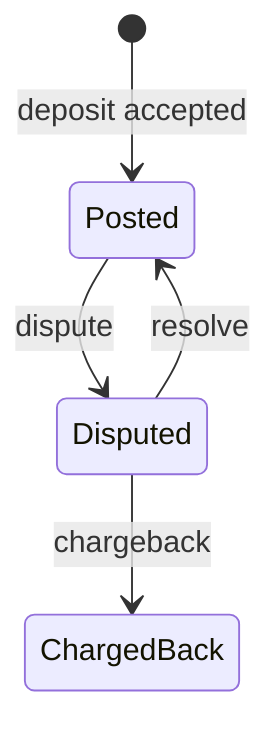

# ledger

A payments engine. It reads a transaction CSV and writes one balance row per client named by a well-formed transaction.

## Run

```sh
cargo run -- input.csv
```

`input.csv` is a small demo. Client 2's withdrawal is larger than the available balance, so it is ignored:

```text
client, available, held, total, locked
1, 1.5000, 0.0000, 1.5000, false
2, 2.0000, 0.0000, 2.0000, false
```

Stdout is only that report. A row that cannot be parsed or applied is skipped, and the rest of the file is processed. `RUST_LOG=debug` prints each skip on stderr with the reason, client, transaction id, amount, and balance. A missing file, or a failure to write the report, is logged at error on stderr and the process exits with an error.

```sh
cargo test
```

## Correctness

`cargo test` is how the handled cases are checked. It runs two layers.

Sample data is in the repo. `datasets/` holds `small_transfers`, `large_transfers`, `small_disputes`, and `large_disputes`, each with a matching `.expected.csv`. `tests/check_output.rs` runs the `ledger` binary on every input and compares stdout with that file. Both sides are sorted by client id. The brief says report order does not matter, and the writer sorts the same way so the files stay easy to diff. `input.csv` is a separate hand-written demo, not one of those fixtures.

Unit tests sit next to the code they cover.

- Amounts accept one to four fractional digits, format back to four places, and reject a fifth digit, a negative, a non-numeric value, or an addition that would overflow.
- A bad row is skipped, and a later deposit still applies.
- A deposit increases available. An exact withdrawal is accepted. A withdrawal that lacks funds leaves its id free.
- A duplicate id is ignored. The client on that row is opened at zero, and the earlier client's funds stay as they were.
- A dispute moves funds to held, even when available goes negative. Disputing a withdrawal, an unknown id, or another client's id changes nothing.
- Resolve and chargeback apply only while the deposit is disputed. After a resolve the same deposit can be disputed again.
- A chargeback locks the client and leaves another dispute held. A locked account ignores every later row.
- A zero amount does not reserve its id or move funds. A rejected withdrawal, dispute, resolve, or chargeback opens the client at zero.
- Overflow and negative held leave the previous state unchanged.
- The report writer emits balances sorted by client id.

The types carry the widths the brief fixes.

- `ClientId` is a `u16`. `TxId` is a `u32`.
- A transaction amount is `Amount<u32>`, non-negative minor units of `1/10_000`.
- Available and held are `Amount<i64>`. A dispute can push available below zero, and held is a sum.
- Balance updates use checked add and subtract. A sum that does not fit is skipped and logged at debug. The printed total is `available + held`, and that addition panics if it does not fit in `i64`.
- A deposit's lifecycle is the `DepositState` enum below. A withdrawal is a separate variant with no dispute state, stored so its id cannot be reused.
- The enum lists the legal states. The tests check which transitions are allowed.

## Deposit state

An accepted deposit starts as `Posted`. A withdrawal is recorded only as a used id.



Dispute moves the deposit's amount from available to held. The total stays the same, and available may go negative. Resolve moves that amount back, and the deposit is `Posted` again, so it can be disputed again. Chargeback removes the amount from held, leaves available where it is, marks the deposit `ChargedBack`, and locks the client. Every later row for that client is then ignored, including a resolve or chargeback of a deposit that is still disputed. `ChargedBack` has no way back.

## Assumptions

The brief says to document a choice when a requirement can be read more than one way. These are the gaps, and how they were filled.

**What "frozen" means.** A chargeback locks the account. The brief does not say what happens to later deposits, withdrawals, disputes, resolves, or chargebacks, or to another deposit that is still under dispute. The lock means this engine takes no further instructions for that client. Downstream systems handle the frozen account. Other disputed deposits stay held, and they cannot be resolved or charged back while the lock stands.

**Which reason is logged for a locked client.** The balances do not depend on whether the lock is checked before the transaction id. The log does. The lock is checked first. If client 2 is locked and the row is `dispute, 2, 50`, the line says the account is locked even when transaction 50 belongs to client 1 or does not exist.

**A chargeback is final, a resolve is not.** The brief says to ignore a resolve or chargeback when the transaction is not under dispute. It does not say whether the same deposit can be disputed again after a resolve, or after a chargeback. After a resolve it is posted again and can be disputed again. After a chargeback it must not be disputed again. On a locked account the logged reason is still the lock, because the lock is checked first.

**Zero amounts.** The brief describes a decimal with up to four places. It does not say what a zero or a negative amount means. A zero deposit or withdrawal is ignored. It does not reserve the transaction id. The client record is still created, with zero funds when this is their first row. A negative amount is a bad row and is skipped with the rest of the malformed input. A row that cannot be parsed does not open a client.

**A blank amount is not a missing column.** Dispute, resolve, and chargeback do not state an amount. The column is still present and left blank (`dispute, 1, 1,`). Any value in it is ignored, and the transaction id is the reference. A row that drops the column (`dispute, 1, 1`) has fewer fields than the header. That row is a broken record and is skipped. Later rows are still applied.

**How big a number can get.** The brief fixes four decimal places, a `u16` client id, and a `u32` transaction id. It does not cap the whole part of an amount, and it does not say what to do when a sum overflows. One transaction is stored as a non-negative `u32` in units of `1/10_000`, so the ceiling for a single amount is `429_496.7295`. Available and held are `i64`: a dispute can push available below zero, and held is the sum of disputed deposits. An addition or subtraction that would overflow, or that would make held negative, skips that row and is logged at debug with the other skips. Values are not wrapped. The printed total is `available + held` as `i64`. If that sum does not fit, writing the report panics.

**A bad row does not stop the process.** The brief says to ignore some business cases, such as a withdrawal without the funds or a dispute of an unknown transaction. It does not say what a malformed row should do to the process, or what an overflow or a subtraction that would push held below zero should do. I treat this as a core piece of a service that cannot afford to crash. Invalid input, overflow, a negative held balance, and a missing client balance skip the row. A missing balance is opened again at zero before the skip is logged. The rest of the file is still applied, and the report is still written. Each skip is logged at debug on stderr, with the reason, client, transaction id, amount, and balance, so the row can be inspected downstream. `RUST_LOG=debug` turns that log on. A missing input file, or a failure to write the report, is logged at error and the process exits. There is no ledger to report.

## Parallelism

I tested sharding the fold by client id, then reverted it. Each client's rows stay in file order and never share a balance, so that part can run on its own thread. Transaction ids are global, so a deposit or withdrawal still has to see every other client's accepted ids. The implementation put that set behind one mutex and took the lock on every such row. On a 10 million row file, one thread took about 3.4 seconds and 18 threads took about 5.5. The extra threads waited on the lock. The program is back to one ledger, applied in file order.

Dropping global uniqueness, or narrowing it to `(client, tx)`, would remove that shared set and make the shards independent. I did not do that. The same transaction id posted by two clients would both be accepted, which is an easy way to credit the same payment twice.
